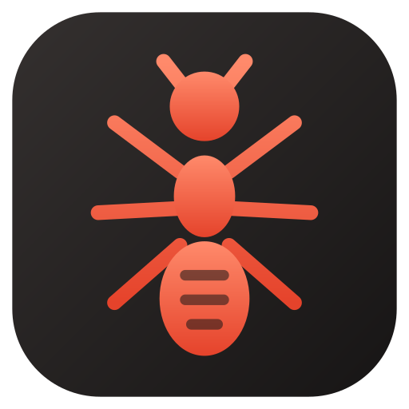
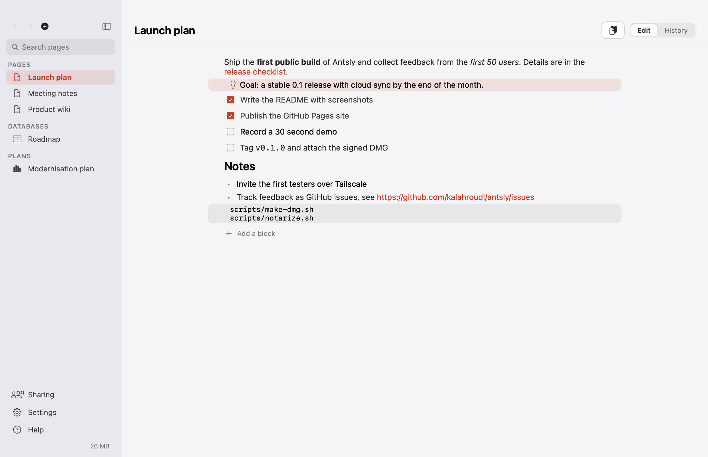
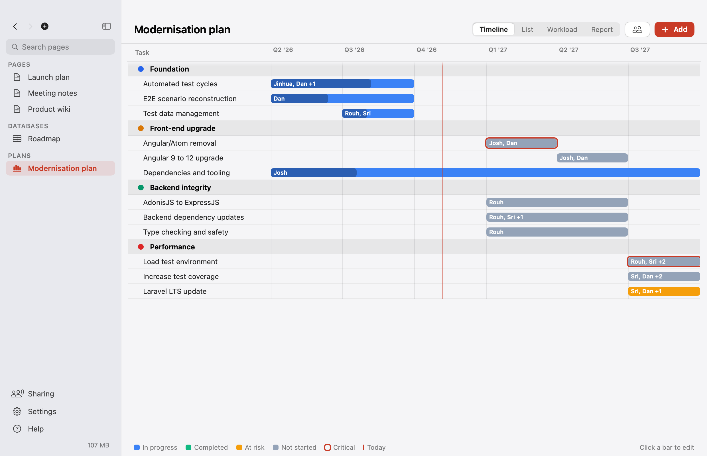
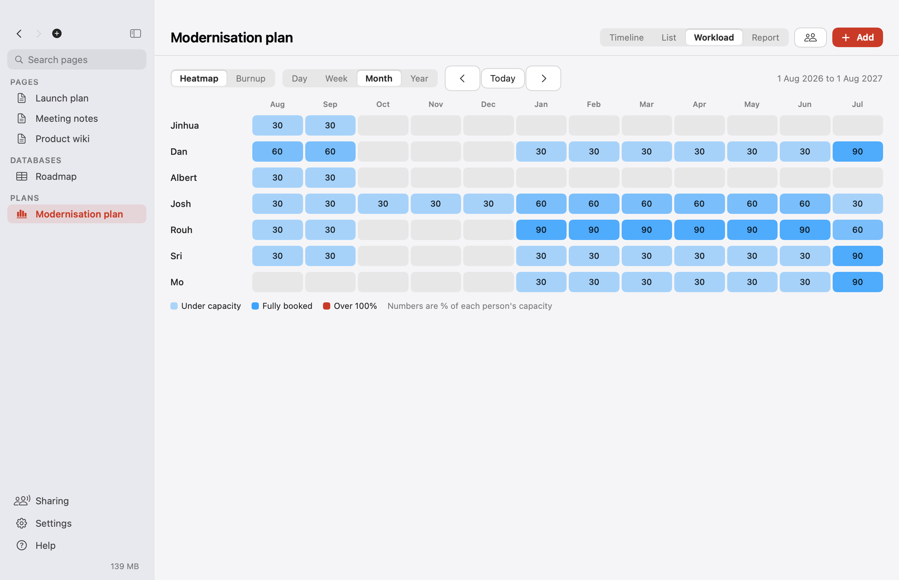
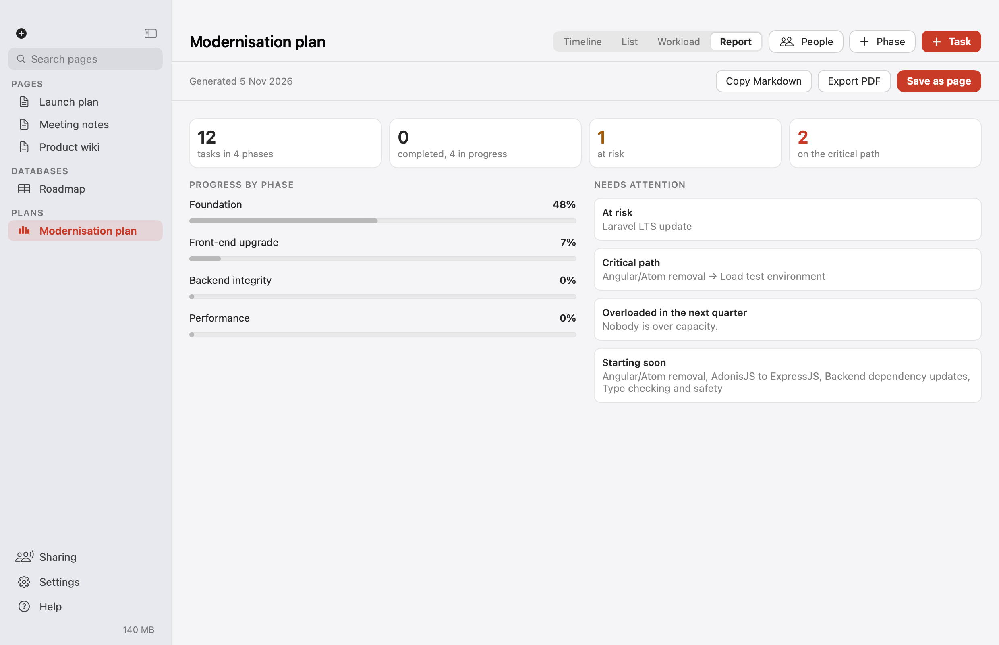
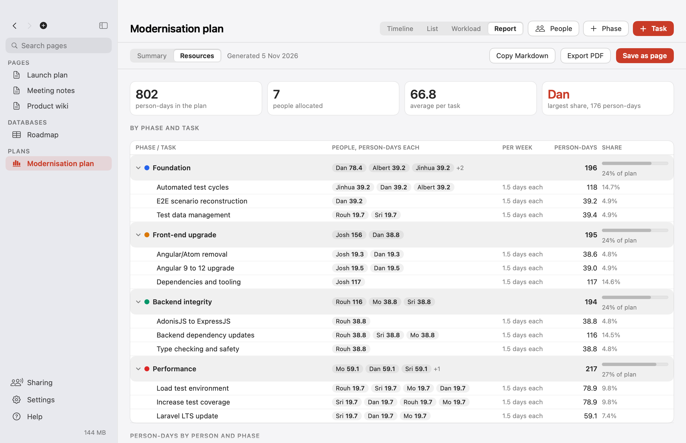
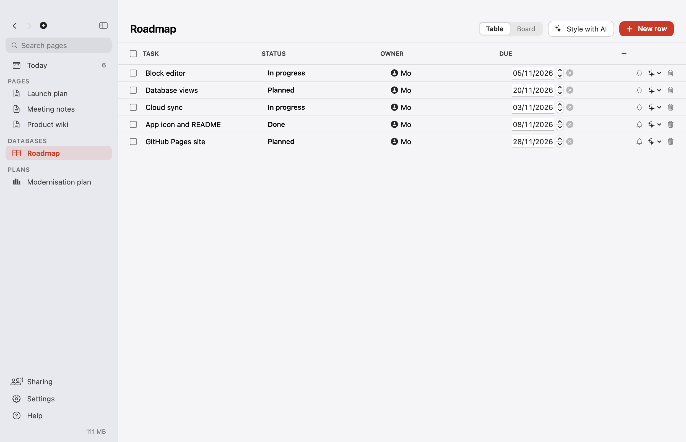
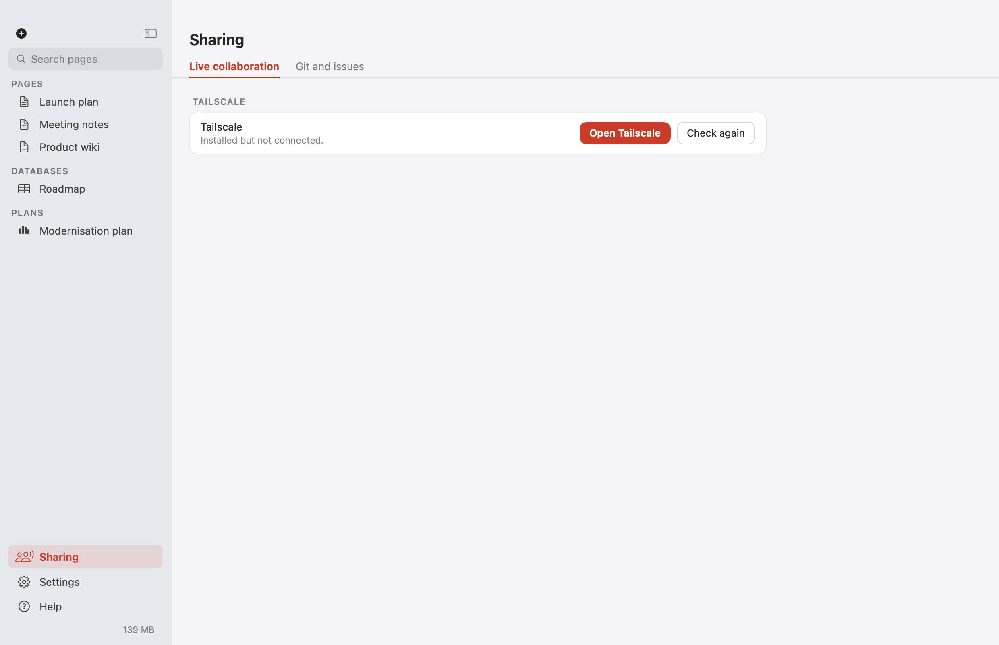

<p align="center"></p>

# Antsly

A native macOS workspace for notes, documents, wikis, databases and project plans. Everything is a plain file in a folder you own. Pure Swift, no third-party packages, idle CPU near zero.



## Install with an AI agent

Paste this into an AI coding agent such as Claude Code. Antsly detects and installs its own prerequisites on first launch, so the agent does not have to:

```text
Install Antsly on this Mac.
1. Run: curl -fsSL https://raw.githubusercontent.com/kalahroudi/antsly/main/scripts/install.sh | bash
2. Antsly opens and its first-run setup checks what it needs and installs whatever is missing. Tell me to click
   "Set everything up" in that window if it is waiting, and wait until it reports everything is ready.
   If a step needs my password, tell me exactly which command to run in Terminal.
3. Register its MCP server: claude mcp add antsly --scope user -- /Applications/Antsly.app/Contents/MacOS/antsly-mcp
4. Call get_status and tell me what it reports.
Never call a destructive tool without asking me first.
```

## What it does

- **Pages**: a block editor with text, headings, to-dos, bullets, callouts and code. Type `/` to change a block. Pages are Markdown files.
- **Rich text**: pages show **bold**, *italic*, `code`, links and web addresses formatted, and switch back to plain Markdown when you click to edit. Copied web and mail content keeps its formatting.
- **Drop and paste**: drop text, images, PDFs or any file onto a page. Text is sorted into to-dos, bullets and headings at once, and "Organise with AI" refines it through your own Claude Code. Files are copied into `assets/`.
- **Databases**: table and board views with typed columns (status, choice, date, person, number, checkbox, link), group edit and delete, and one-click prompts for your AI agent. Rows are JSON files.
- **Project plans**: phases and tasks on a timeline, per-person allocation and capacity, a resource heatmap by day, week, month or year, a burnup chart (person-days, story points or tasks), a critical path and one-click status reports as a page, Markdown or PDF. Imports a Gantt Magic backup.
- **Version history**: git under the hood. See what changed, restore a page, resolve a conflict by picking a side. No command line.
- **GitHub issues**: pulled into a database and pushed back through your own `gh` sign-in. Antsly never sees a password.
- **Cloud sync**: one switch moves the workspace into iCloud Drive. No account, no server.
- **Live collaboration**: share a workspace with people on your Tailscale network. They join with a link, you approve each person once, and edits merge as you type.
- **Menu bar and Dock**: a popover with recent pages and a quick note. Light and dark themes everywhere.
- **Setup inside the app**: first launch checks Git, the workspace folder, Tailscale and the GitHub tool, installs what it can and shows a copyable command for anything that needs your password.
- **Agents**: ships an MCP server (`antsly-mcp`) and connects to Claude Code, Claude Desktop, Cursor and others from Settings.

| | |
|---|---|
|  |  |
|  |  |
|  |  |

## First release notes

- Live editing merges **block by block, last writer wins**. Two people in different blocks never conflict. Two people typing in the same block keep the newest edit. Character-level merging is planned.
- The host Mac must be online for live editing. Guests keep a local copy and catch up when it returns.
- A joined workspace's pages are merged into your own workspace.
- Jira is not connected yet. Plans link tasks to external items so a Jira adapter can be added without changing plan files.

## Build

```sh
swift build && swift test
scripts/bundle.sh          # builds dist/Antsly.app
dist/Antsly.app/Contents/MacOS/Antsly --self-test
```

Requires macOS 14 or later and the Swift 6 toolchain.

## Where your data lives

`~/Documents/Antsly/` (or iCloud Drive when sync is on): `pages/*.md`, `databases/*.json`, `plans/*.json`, `assets/*`. App logs and update files live in `~/Library/Application Support/Antsly/`. Delete both to uninstall completely.

## License

Apache-2.0. See [LICENSE](LICENSE).
